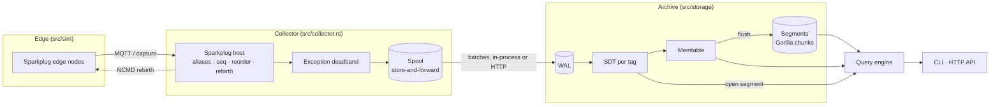

# tagvault

[](https://github.com/SlateGitOrg/tagvault/actions/workflows/ci.yml)

A process historian for plant telemetry, written in Rust. It ingests **MQTT Sparkplug B**,
reduces data with an exception deadband and a **swinging-door compressor whose error bound is
proven and property-tested**, and stores the result in **Gorilla-encoded columnar chunks**
behind a **crash-safe write-ahead log**. It buffers through link outages with
**store-and-forward**, and answers **raw, interpolated and time-weighted-average** queries from
a CLI and a small HTTP API.

```
Sparkplug B edge ──MQTT──▶ host (aliases, seq, rebirth) ─▶ exception ─▶ spool ══link══▶ WAL ─▶ SDT ─▶ Gorilla segments ─▶ queries
```

> All data is simulated (see [DATA.md](DATA.md)). tagvault has not been used in production.

## Why

Plant data is big and boring: thousands of tags, sampled every second, mostly noise around a
setpoint. Historians such as OSIsoft/AVEVA PI made this tractable decades ago. They report by
exception at the interface, compress with a "swinging door" at the archive, and buffer when the
WAN drops. tagvault rebuilds that pipeline for a modern edge protocol, Sparkplug B, and writes
down the guarantees that commercial systems usually leave implicit:

* **Bounded error.** The textbook swinging-door algorithm can exceed its configured deviation.
  The benchmark measured this on 16 of 16 held-out pressure series. tagvault's default
  *lookback* rule archives only measured values and provably keeps every sample within
  `comp_dev`. The bound for the whole pipeline is `2·exc_dev + comp_dev`, and that is
  property-tested end to end.
* **Exact crash recovery.** A crash at any byte of the WAL recovers to exactly the committed
  prefix. A property test checks this, along with a SIGKILL test that kills a real writer
  process.
* **Sparkplug semantics.** The host handles birth and death certificates, metric aliases,
  sequence-number gaps with a reorder window, `Node Control/Rebirth` requests, and `bdSeq`
  matching for late deaths.

**Who it's for.** OT/IIoT engineers who want to see how a historian works inside, and people
evaluating SDT settings for their tags.

## Features

| area | what's there |
|---|---|
| Sparkplug B 3.0 | protobuf decode (no `protoc` needed); NBIRTH/DBIRTH/NDATA/DDATA/NDEATH/DDEATH/STATE topics; alias resolution; seq checks with a reorder window; rebirth via NCMD with a cooldown; `bdSeq` death matching; `Quality` property; `is_null`, `is_transient`, `is_historical` |
| MQTT | minimal MQTT 3.1.1 client: QoS 0/1, keep-alive, last will; Sparkplug host `STATE` birth and will. `tagvault mqtt` for live ingest, `tagvault edge-sim` publishes a simulated plant |
| Compression | exception deadband (collector) + swinging door (archive): **lookback** (default), **strict**, **classic** (comparison only); discrete tags archive on change |
| Storage | WAL of raw points and checkpointed compressor state; immutable segments with delta-of-delta timestamps, XOR values, RLE quality, per-chunk CRC and a min/max/time index; orphan-segment cleanup; directory lock |
| Store-and-forward | disk FIFO spool, atomic cursor, exponential backoff, `DropOldest`/`RejectNew`, at-least-once delivery made idempotent by the archive |
| Queries | raw, interpolated (linear/step, never extrapolated), per-interval time-weighted average, min, max, count, coverage |
| Interfaces | CLI (`simulate`, `ingest`, `mqtt`, `edge-sim`, `serve`, `tags`, `query`, `verify`, `bench`); HTTP JSON API with binary ingest |
| Simulation | seeded tank/temperature/flow/pressure models; Sparkplug edge nodes; lossy broker link (drops, swaps, node restart) |

## Architecture



The deeper design is in [docs/ARCHITECTURE.md](docs/ARCHITECTURE.md): the host state machine,
the write path and recovery protocol, the segment format, query algorithms and their
complexity. [docs/SDT.md](docs/SDT.md) has the compression algorithms with proofs.
[docs/HISTORIAN_COMPARISON.md](docs/HISTORIAN_COMPARISON.md) maps tagvault onto PI/AVEVA-style
historians.

## Quick start

Requirements: Rust 1.89 or newer. For `make check` you also need `cargo-llvm-cov` (`cargo
install cargo-llvm-cov`, plus `rustup component add llvm-tools-preview`).

```bash
make check     # fmt check + clippy -D warnings + all tests under coverage (fails below 90 % lines)
make demo      # offline end-to-end demo (below)
make bench     # compression + query benchmarks → out/bench/bench.{md,json}
make integration   # optional: real Mosquitto broker in Docker; skips if Docker is absent
```

Use it yourself:

```bash
cargo build --release
B=target/release/tagvault
$B simulate --out plant.tvcap --hours 2                       # record a simulated plant
$B ingest --capture plant.tvcap --data ./archive --policy fixtures/policy.json --outage 40m:15m --events
$B query agg --data ./archive --tag Plant1/Line1/Tank01/Level \
   --start 2026-01-05T00:00:00Z --end 2026-01-05T02:00:00Z --interval 15m
$B serve --data ./archive --listen 127.0.0.1:8080              # then GET /api/v1/tags, /raw, /interpolated, /aggregate

# live: a real broker, a simulated edge, and the host
$B mqtt --broker 127.0.0.1:1883 --data ./live --group Plant1 --comp-dev 0.1 &
$B edge-sim --broker 127.0.0.1:1883 --group Plant1 --nodes 2 --seconds 600 --speed 10
```

Times accept epoch milliseconds, RFC 3339 UTC, or PI-style relative times (`*-1h`). Per-tag
deviations come from a JSON policy of glob rules (example: [`fixtures/policy.json`](fixtures/policy.json)).

## Demo (real output of `make demo`)

The demo simulates 2 hours of a 2-line plant over a lossy link. It ingests the capture with the
archive link down from 00:40 to 00:55, queries the result, serves it over HTTP, and recovers
from a torn WAL write. Recorded on an Apple M1 Pro, macOS 26.6; only the `done in` time depends
on the machine.

```text
== 1. Simulate 2 h of a 2-line plant (Sparkplug B edge nodes, lossy broker link, one node restart)
capture   out/demo/plant.tvcap (28805 frames, 3.2 MB)
window    2026-01-05T00:00:00.000Z → 2026-01-05T02:00:00.000Z
scenario  2 nodes × (Tank01, Reactor01); published 28818 msgs, lost 13, swapped 13, node restarts 1, rebirths honoured 13

== 2. Ingest: host → exception filter → spool → archive, with the archive link down 00:40–00:55
replaying 28805 frames from out/demo/plant.tvcap
  link outage 2026-01-05T00:40:00.020Z → 2026-01-05T00:55:00.020Z
  [birth]   Plant1/Line1 bdSeq=0 metrics=3
  [birth]   Plant1/Line2 bdSeq=0 metrics=3
  [gap]     Plant1/Line1 expected seq 67, got 68 → buffering
  [reorder] Plant1/Line1 gap filled, 1 buffered message(s) applied in order
  [gap]     Plant1/Line1 expected seq 198, got 199 → buffering
  [reorder] Plant1/Line1 gap filled, 1 buffered message(s) applied in order
  [gap]     Plant1/Line2 expected seq 243, got 244 → buffering
  [rebirth] NCMD Node Control/Rebirth → Plant1/Line2 (sequence gap not filled within reorder timeout)
  [birth]   Plant1/Line2 bdSeq=0 metrics=3
  [reorder] Plant1/Line2 gap filled, 1 buffered message(s) applied in order
  [rebirth] NCMD Node Control/Rebirth → Plant1/Line1 (sequence gap not filled within reorder timeout)
  [rebirth] NCMD Node Control/Rebirth → Plant1/Line1 (sequence gap not filled within reorder timeout)
  [death]   Plant1/Line1 → all its tags marked stale
  … 56 more session events (see the counters below)
sparkplug  messages=28805 births=48 deaths=1 data=28682 seq_gaps=26 reordered=13 rebirth_requests=13 discarded=74
exception  samples_in=85693 reported=34624 (40.4% kept)
forward    batches=7012 delivered=7012 failed_attempts=35 max_backlog=886 left_in_spool=0
archive    tags=14 archived_points=3524 segment_bytes=17350 duplicates_rejected=0 (24.3x fewer points than decoded)
done in 1.45s

== 3. Tags
tag                                          kind   archived  comp_dev  snapshot
Plant1/Line1/Reactor01/CoolantFlow         analog        793       0.8  26.533 @ 2026-01-05T02:00:00.000Z
Plant1/Line1/Reactor01/Pressure            analog        869      0.02  4.960 @ 2026-01-05T02:00:00.000Z
Plant1/Line1/Reactor01/Temperature         analog         35       0.3  65.582 @ 2026-01-05T02:00:00.000Z
Plant1/Line1/Tank01/InletFlow              analog         94       0.8  41.812 @ 2026-01-05T02:00:00.000Z
Plant1/Line1/Tank01/Level                  analog         19       0.2  71.320 @ 2026-01-05T02:00:00.000Z
Plant1/Line1/Tank01/PumpRunning          discrete          8         0  1.000 @ 2026-01-05T02:00:00.000Z
Plant1/Line1/Uptime                        analog          4       0.5  7200.000 @ 2026-01-05T02:00:00.000Z
… (Line2 tags elided)

== 4. 15-minute time-weighted average / min / max of Plant1/Line1/Tank01/Level
interval start                    twa        min        max  count coverage
2026-01-05T00:00:00.000Z       72.926     62.983     80.081      2   100.0%
2026-01-05T00:15:00.000Z       58.657     45.817     71.376      2   100.0%
2026-01-05T00:30:00.000Z       36.815     30.142     45.817      2   100.0%
2026-01-05T00:45:00.000Z       53.317     40.200     66.545      4   100.0%
2026-01-05T01:00:00.000Z       74.232     67.128     79.857      3    86.7%
2026-01-05T01:15:00.000Z       53.786     40.291     67.128      2   100.0%
2026-01-05T01:30:00.000Z       36.874     29.909     46.056      2   100.0%
2026-01-05T01:45:00.000Z       58.745     46.056     71.320     14   100.0%

== 5. Interpolated Plant1/Line1/Reactor01/Temperature across the Line1 restart at 01:00 (stale while offline)
time                              value
2026-01-05T00:58:00.000Z         81.546
2026-01-05T00:59:00.000Z         82.049
2026-01-05T01:00:00.000Z              -
2026-01-05T01:01:00.000Z              -
2026-01-05T01:02:00.000Z         82.943
2026-01-05T01:03:00.000Z         83.086
2026-01-05T01:04:00.000Z         83.229

== 6. Raw values of the discrete tag Plant1/Line1/Tank01/PumpRunning (first 6)
time                              value  quality
2026-01-05T00:00:00.000Z         1.0000  Good
2026-01-05T00:10:01.000Z         0.0000  Good
2026-01-05T00:39:04.000Z         1.0000  Good
2026-01-05T00:59:59.000Z         1.0000  Good
2026-01-05T01:00:00.000Z            NaN  Stale
2026-01-05T01:02:00.000Z         1.0000  Good

== 7. HTTP API: GET /api/v1/aggregate
{"rows":[{"avg":5.007497468458282,"count":218,"coverage":1.0,"end":1767573000000,"max":5.249180316925049,"min":4.813318252563477,"start":1767571200000},{"avg":4.991257562173738,"count":195,"coverage":1.0,"end":1767574800000,"max":5.21107816696167,"min":4.849289417266846,"start":1767573000000}],"tag":"Plant1/Line2/Reactor01/Pressure"}

== 8. Crash simulation: append a torn record to the WAL, then reopen
[2026-10-25T08:08:55Z WARN  tagvault::storage::wal] WAL out/demo/archive/wal.log: truncating 7 byte torn tail
recovery  replayed_records=0 replayed_points=0 truncated_bytes=7 orphan_segments_removed=0 temp_files_removed=0
archive   tags=14 segments=1 segment_bytes=17350 wal_bytes=9535 segment_points=3524 memtable_points=0
verified  3524 points, all chunk checksums OK
```

What the output shows:

* **Lost messages.** Lost DDATA messages open sequence gaps. Swapped messages are reordered
  within the 2 s window. A gap that never fills ends in an `NCMD` rebirth, which the simulated
  node honours.
* **Outage.** The 15-minute outage built a backlog of 886 batches. All of it drained, with no
  duplicates.
* **Restart.** Line1's restart at 01:00 appears as `Stale` points. Interpolation reports `-`
  (undefined) while the node is offline instead of inventing values, and the 01:00 interval
  shows 86.7 % coverage.
* **Noise sets the compression.** Noisy flows and pressure need many points at the deviations
  chosen in `fixtures/policy.json`. Level and temperature need almost none: 19 and 35 points
  for 2 hours.

## Benchmarks

Command: `make bench` (same as `tagvault bench --out out/bench`). Signals come from
`src/sim/signals.rs`. Per class there are 8 tuning series (seeds 1–8) and 16 held-out series
(seeds 101–116), each 6 hours at 1 s.

Method:

* **Tuning.** For each class, pick the largest deviation on the grid (0.02 %–1 % of span) whose
  mean RMSE on the tuning seeds is ≤ 0.1 % of span. `exc_dev = comp_dev/2`.
* **Held-out.** Apply those settings to the held-out seeds and report the results.

The compression numbers are deterministic. The timing numbers were measured on an Apple M1 Pro
(macOS 26.6, release build) and will vary.

**Held-out results at the tuned deviation.** Ratios are raw points / stored points. "Bound" is
the guaranteed `2·exc + comp`.

| class | comp dev (% span) | exception only | **lookback SDT** | strict SDT | classic SDT | bytes / stored pt | byte ratio vs 16 B/sample (lookback) | lossless Gorilla on raw | max error / bound (lookback, strict, classic) | classic bound violations | RMSE (% span) |
|---|---|---|---|---|---|---|---|---|---|---|---|
| tank_level | 0.20 | 2.13x | **374.8x** | 57.7x | 610.6x | 9.23 | 650.1x | 2.22x | 0.793, 0.711, 0.995 | 0/16 | 0.0678 |
| temperature | 0.20 | 3.07x | **259.5x** | 44.4x | 335.2x | 8.58 | 483.6x | 2.34x | 0.755, 0.774, **1.030** | 2/16 | 0.0704 |
| flow | 0.20 | 1.02x | **1.3x** | 1.3x | 1.5x | 8.24 | 2.6x | 2.04x | 0.713, 0.709, 0.940 | 0/16 | 0.0568 |
| pressure | 0.20 | 1.46x | **8.6x** | 5.7x | 12.2x | 7.70 | 17.9x | 2.37x | 0.858, 0.854, **1.287** | 16/16 | 0.0998 |

**Trade-off on the tuning split.** Lookback ratio / strict ratio at each deviation (% of span):

| class | 0.05 % | 0.10 % | 0.20 % | 0.50 % | 1.00 % |
|---|---|---|---|---|---|
| tank_level | 2.1x / 1.9x | 9.3x / 4.1x | 405.6x / 60.2x | 1129.4x / 1060.1x | 1440.0x / 1416.4x |
| temperature | 2.0x / 1.8x | 7.4x / 3.8x | 244.1x / 43.7x | 642.4x / 610.6x | 939.1x / 924.1x |
| flow | 1.1x / 1.1x | 1.1x / 1.1x | 1.3x / 1.3x | 2.2x / 1.9x | 9.5x / 4.3x |
| pressure | 1.6x / 1.5x | 2.7x / 2.3x | 8.5x / 5.7x | 62.4x / 45.0x | 251.2x / 181.5x |

**Query benchmark.** 64 held-out tags; 1 382 400 raw points stored as 304 346 points in
2 413 644 segment bytes.

| metric | value |
|---|---|
| ingest into `Archive::write` (exception-filtered points/s, WAL without fsync) | 4 409 501 |
| fsync'd 1 000-point batch commit, p50 | 4.93 ms |
| raw query over 6 h, p50 | 112 µs |
| 1-minute interpolated grid over 6 h, p50 | 105 µs |
| 15-minute TWA/min/max/count over 6 h, p50 / p95 | 105 / 749 µs |
| worst 15-minute TWA error, archive vs raw | 0.05079 % of span (0.127 of the bound) |

How to read this:

* **Lookback vs strict.** Lookback keeps strict mode's guarantees (bounded error, measured
  values only) at 5.8–6.5x higher compression on tank level and temperature.
* **Classic.** Textbook SDT compresses up to 1.6x more than lookback but breaks its bound. On
  pressure it did so in every held-out series.
* **Flow is noise.** Flow's measurement noise (σ ≈ 0.5 % of span) exceeds the tuned deviation,
  so nothing can be dropped without violating the RMSE target. The trade-off table shows what a
  larger deviation buys.
* **Gorilla on its own.** Gorilla alone gives about 2.0–2.4x losslessly. Most of the reduction
  comes from compression choosing fewer points.

## Tests and coverage

`make check` runs `cargo fmt --check`, `cargo clippy --all-targets -- -D warnings` (which also
type-checks), and the full test suite under `cargo llvm-cov` with `--fail-under-lines 90`. The
latest run passed 108 tests with **96.78 % line coverage** of the library (`src/main.rs` is
excluded from the percentage and exercised by `tests/cli.rs`).

| suite | what it proves |
|---|---|
| `tests/properties.rs` | SDT error ≤ `comp_dev` (strict and lookback, with bad-quality points); deadband hold ≤ `e`, linear ≤ `2e`; pipeline ≤ `2e + d`; Gorilla/chunk/batch round-trips; decoders never panic on garbage; exact TWA vs numeric integration; spool behaves as a durable FIFO across restarts |
| `tests/crash_recovery.rs` | torn last commit at any byte → recovered archive equals a never-crashed reference; SIGKILLed writer process → recovered data equals an uninterrupted compressor |
| `tests/sparkplug_host.rs` | spec-modelled NBIRTH/DBIRTH/DDATA decode with an independent wire encoder; sign extension; reorder within timeout; timeout → NCMD rebirth (payload decoded); seq wrap 255→0; duplicates; unknown alias/device; data before birth; NDEATH `bdSeq` match vs. late death; DDEATH; null/quality/transient/historical; cooldown |
| `tests/pipeline.rs` | 90-minute plant scenario through host, deadband, spool (20-minute outage) and archive: every decoded sample within `2e + d` of the archive |
| `tests/archive.rs` | reopen equality, chunk-boundary reads, idempotent redelivery, quality/discrete round-trips, orphan/temp cleanup, corrupt segment detection, directory lock, policy re-application |
| `tests/net.rs` | HTTP API over a real socket (ingest via `HttpSink`, every endpoint, error codes); MQTT host against an in-process fake broker (STATE birth, QoS 1 acks, gap → NCMD) |
| `tests/cli.rs` | the binary end to end: simulate → ingest → tags/query (3 formats) → torn WAL → verify; `bench --quick`; `serve` + `ingest --forward-to` over HTTP |
| unit tests in `src/` | codecs, frames, WAL, segments, spool, config globs, time parsing, query edge cases, simulator determinism |

`make integration` (optional, Docker) runs `tagvault mqtt` and `tagvault edge-sim` against
Eclipse Mosquitto 2.0.20. On the development machine all 14 tags arrived and `verify` passed.

## Design decisions (short)

Full list with costs: [DECISIONS.md](DECISIONS.md).

* **Lookback SDT** is the default: measured values only, a proven bound, and near-textbook
  compression. Strict and classic are kept for comparison.
* **Collector and archive split.** Exception filtering happens at the collector and
  compression at the archive. The spool sits between them.
* **WAL contents.** The WAL logs raw points plus checkpointed compressor state, so recovery is
  exact rather than approximate.
* **Monotonic timestamps per tag.** Redelivery becomes idempotent; the price is that late
  history is rejected.
* **Deliberately small dependencies.** Hand-written prost structs (no `protoc`), a minimal
  synchronous MQTT client, tiny_http, and no async runtime.

## Limitations

* **Simulated data only.** Compression ratios on real plants depend on noise and on the
  deviations engineers choose. Nothing here is calibrated against real equipment.
* **No late or out-of-order history.** Points older than a tag's latest point are rejected
  (counted). Sparkplug `is_historical` backfill that arrives after live data is lost.
* **No security.** No TLS on MQTT or HTTP. The HTTP API has no authentication; bind it to
  localhost. MQTT username and password are supported, without TLS.
* **MQTT subset.** No QoS 2, no persistent sessions, no automatic reconnect: `tagvault mqtt`
  exits when the broker disconnects.
* **Numeric values only.** Strings, DataSets, Templates and Bytes are not historized. 64-bit
  integers lose precision above 2^53.
* **Single node.** Single writer per archive directory, no replication, no retention or
  rollover. Segments accumulate until deleted. Queries cannot run in a separate process while
  `serve` holds the archive; use the HTTP API.
* **Durability scope.** On macOS, `fsync` is not `F_FULLFSYNC`, so the drive cache can still
  lose acknowledged writes on power loss. `ingest` of a capture defaults to `--sync os`.
* **Lookback memory.** Each tag buffers up to 4 096 uncompressed points in its open segment.
  The open segment is checkpointed, but it is held in memory.
* **Reorder losses.** Messages buffered behind a sequence gap that never fills are discarded,
  and data is lost until the rebirth.
* **Spec examples are modelled.** The "spec example" decode tests are based on the Sparkplug
  3.0 examples but are not byte-for-byte copies of official vectors.
* **Benchmark scale.** The benchmark covers 64 tags and 1.4 M points on one laptop. Nothing
  larger has been measured.

## Roadmap

* Out-of-order inserts by rewriting the affected chunk, so edge backfill (`is_historical`) is
  kept.
* Retention policies and time-partitioned segment compaction.
* TLS for MQTT and HTTP, an authenticated API, and MQTT reconnect with session resumption.
* Sparkplug DataSet and Template metrics, and string tags with dictionary encoding.
* Percent-of-span deviations using Sparkplug engineering-range properties.
* Parallel query execution across tags, and an async collector for high fan-in.

## Repository layout

```
src/
  sparkplug/   proto, topic, datatype, host state machine
  compress/    deadband, sdt (lookback/strict/classic)
  encoding/    bits, gorilla, varint
  storage/     frame, wal, segment, archive
  forward/     spool, batch, forwarder + sinks
  query/       raw / interpolated / aggregate
  net/         mqtt client + host loop, http api + sink
  sim/         rng, signals, edge node, scenario + capture files
  collector.rs config.rs bench.rs timefmt.rs main.rs
tests/         properties, crash_recovery, sparkplug_host, pipeline, archive, net, cli
docs/          ARCHITECTURE.md, SDT.md, HISTORIAN_COMPARISON.md
scripts/       demo.sh, integration.sh, loc.sh
fixtures/      policy.json
```

Size (`make loc`): about 7 500 lines of non-test Rust in `src/` (about 5 900 without comments
and blank lines), 1 200 lines of inline unit tests, and 1 600 lines of integration and property
tests.

## License

MIT. See [LICENSE](LICENSE).
