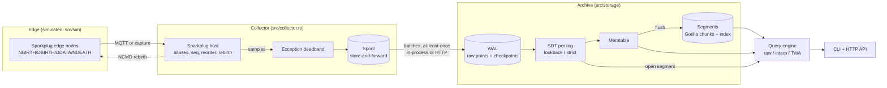

# Architecture

tagvault is one Rust crate: a library (`src/lib.rs`) and the `tagvault` binary
(`src/main.rs`). Data moves through it in the same stages a PI/AVEVA-style historian uses. An
interface/collector node decodes field protocols, filters exceptions and buffers. An archive
node compresses, stores and serves queries.



## Module map

| module | responsibility |
|---|---|
| `sparkplug::proto` | `sparkplug_b.proto` as hand-written prost derives (no `protoc` at build time) |
| `sparkplug::topic` | `spBv1.0/<group>/<type>/<edge>[/<device>]` and `STATE` topics, validation |
| `sparkplug::datatype` | datatype codes; numeric conversion with sign extension for Int8/16/32 |
| `sparkplug::host` | Host Application state machine (births, aliases, seq, reorder, rebirth, deaths) |
| `compress::deadband` | exception filter (collector side) |
| `compress::sdt` | swinging-door compression, three modes (see [SDT.md](SDT.md)) |
| `encoding::{bits,gorilla,varint}` | bit streams, delta-of-delta timestamps, XOR floats, varints |
| `storage::frame` | `[len][crc32][payload]` framing with torn-tail detection |
| `storage::wal` | write-ahead log: checkpoint, tag definitions, point batches |
| `storage::segment` | immutable segment files: columnar chunks + checksummed footer index |
| `storage::archive` | the engine: validation, WAL, SDT, memtable, flush, recovery, range reads |
| `forward::{spool,batch}` | disk FIFO with durable cursor; batch wire format |
| `forward` | `Sink` trait, archive/outage sinks, forwarder with exponential backoff |
| `collector` | host → exception → spool → sink, plus `replay` for captures |
| `query` | raw, interpolated, per-interval TWA/min/max/count |
| `net::mqtt` | minimal MQTT 3.1.1 client + Sparkplug host loop (`STATE` birth and will) |
| `net::http` | JSON query API + binary ingest endpoint (tiny_http), HTTP sink |
| `sim` | seeded process signals, Sparkplug edge node, lossy-link scenario, capture files |
| `bench` | tuning/held-out compression benchmark, query benchmark |
| `config` | per-tag policy (glob patterns, deviations, max times, SDT mode) |
| `timefmt` | RFC 3339 / epoch-ms / `*-1h` parsing |

## Sparkplug host state machine

One session per `(group, edge node)`:

```
            NBIRTH(seq s, bdSeq b)                    in-order DBIRTH/DDATA/NDATA/DDEATH
  (none) ─────────────────────────▶ ONLINE(expected = s+1) ───────────────────────────▶ ONLINE
                                       │   seq ahead (gap)                                   ▲
                                       ├──────────────▶ buffer in reorder map ── filled ──────┘
                                       │                   │ not filled after reorder_timeout_ms
                                       │                   ▼
                                       │          AWAITING_REBIRTH ── NCMD Node Control/Rebirth
                                       │   unknown alias / unknown device / missing seq ──▶ (same)
                                       │   NDEATH with matching bdSeq ──▶ OFFLINE (all tags Stale)
                                       ▼   NDEATH with older bdSeq ──▶ ignored (late death)
```

* Aliases are scoped to the node session. A DDATA that names a node-level alias is rejected.
* An unknown alias discards the whole message. If the host's view of the aliases is wrong,
  nothing in that message can be trusted.
* Rebirth requests are rate-limited per node (`rebirth_cooldown_ms`, 5 s by default).
* `bdSeq` and `Node Control/*` metrics describe the session, so they are not historized.
  Metrics flagged `is_transient` are skipped. String, bytes, DataSet and Template values are
  counted as unsupported.
* Metric quality comes from `is_null` (→ Bad) and the reserved `Quality` property (192 → Good,
  500 → Stale, anything else → Bad).

Cost per message: O(metrics). Memory: O(defined metrics + reorder buffer ≤ 127 messages).

## Archive write path and crash safety

1. **Validate.** Resolve or create each tag. A new tag logs a `TagDef` record that includes its
   compression settings. Points whose timestamp is not after the tag's last accepted timestamp
   are rejected and counted. This also makes redelivery from the spool idempotent.
2. **Log.** All accepted points of the batch go into one `Points` record, followed by one
   `write + fsync` (`SyncMode::Always`; `Os` skips the fsync).
3. **Apply.** Each point is fed to its tag's compressor. Points the compressor archives go to
   the memtable.
4. **Flush** when the memtable reaches 50 000 points or the WAL reaches 32 MiB:
   * write `segments/seg-N.tvs.tmp`, fsync, rename, fsync the directory;
   * write `wal.tmp` containing one `Checkpoint` (every tag's compressor state, including the
     open lookback segment and the last timestamp), fsync, rename over `wal.log`, fsync the
     directory.

**Recovery** (`Archive::open`):

* Remove `*.tmp` files.
* Delete segments whose id is greater than the checkpoint's `last_segment`. These come from a
  flush that crashed before its checkpoint landed, and their contents are still in the WAL.
* Load the checkpoint, then replay the WAL records after it through the same deterministic
  `apply` path.
* Truncate any torn tail: the first frame that is short or fails its CRC, and everything after.

The resulting state is bit-identical to an archive that never crashed and received exactly the
fully committed batches. Two tests check this. `torn_last_commit_recovers_to_committed_prefix`
is a property test that tears the last commit at every possible byte.
`sigkill_during_writes_recovers_a_consistent_prefix` re-executes the test binary as a writer,
kills it with SIGKILL at five different moments, and compares the result with an uninterrupted
compressor.

**Policy changes.** On open, the policy file is applied to existing tags. If any setting
changed, a checkpoint is written immediately. Later WAL records are therefore always replayed
under the settings they were written with. Read-only tools (`tags`, `query`, `verify`) open with
`reconfigure_existing = false`.

A directory lock (`LOCK`, `File::try_lock`) stops two processes from opening the same archive or
spool.

## Segment format

```
"TVSEG001"
chunk*:  uvarint len, timestamps (delta-of-delta / GCD unit)
         uvarint len, values (Gorilla XOR)
         uvarint runs, (quality u8, uvarint run)*
index:   56 B per chunk: tag u32, offset u64, len u32, crc u32, count u32,
         t_min i64, t_max i64, v_min f64, v_max f64
footer:  index_len u32, crc32(index) u32, "TVSEGEND"
```

**Timestamps.** The first timestamp is stored raw. After that, each delta-of-delta is divided by
the chunk's GCD unit, so a 1 s scan in milliseconds costs nothing extra. It is then stored in
one of the buckets `0`, `10`+7 bits, `110`+9 bits, `1110`+12 bits, `11110`+32 bits, or
`11111`+64 bits. The 32-bit bucket was added because SDT-archived points arrive at irregular
intervals. A one-day gap would not fit in the 12-bit bucket.

**Values.** Each value is XOR-ed with the previous one. A repeated value costs one bit. A new
value is stored either inside the previous leading/trailing-zero window or with a fresh 5-bit
leading-zero count and 6-bit length.

**Measured size.** On held-out SDT output: 7.7–9.2 bytes per archived point. On raw 1 s
samples: about 2.0–2.4x lossless (`make bench`).

## Reads and queries

`Archive::series(tag, start, end)` binary-searches the tag's time-ordered chunk list
(O(log C)). It decodes the chunks that overlap the range, plus the nearest chunk on each side,
so boundary interpolation has neighbours. It then appends the memtable and the open
compression segment, which holds exact recent samples, and trims the result to the range plus
one point on each side.

| query | algorithm | cost |
|---|---|---|
| raw | filter | O(n) |
| interpolated (step `Δ`) | one merge pass over points and the grid | O(n + k) |
| aggregate (interval `I`) | one pass; each segment is integrated with the trapezoid rule on the part that overlaps each interval; min and max include interpolated interval-boundary values | O(n + k) |

Aggregate semantics:

* The time-weighted average is the integral of the reconstruction divided by the *covered*
  time. Time after a Bad or Stale point, and time after the last point, is uncovered.
* `coverage` reports the covered fraction of the interval.
* `count` is the number of stored good points in `[a, b)`.
* Queries never extrapolate past the snapshot.

## Store-and-forward

* The spool is a sequence of append-only segment files (1 MiB by default) of CRC-framed batches.
* The acknowledgement cursor `(segment, offset)` is replaced atomically.
* Segments that have been fully acknowledged are deleted.
* At capacity (256 MiB by default), `DropOldest` deletes the oldest segment and `RejectNew`
  refuses the push. Both are counted.
* The forwarder delivers in order. On a transient failure it backs off exponentially (500 ms
  doubling to 30 s). A batch the archive rejects permanently is dead-lettered (counted and
  skipped) rather than blocking the queue.
* Delivery is at-least-once. Duplicates are absorbed by the archive's monotonic-timestamp check.

## Concurrency model

* The archive is single-writer. The HTTP server wraps it in `RwLock`: queries take the read
  lock and ingest takes the write lock.
* The collector runs single-threaded. Its MQTT loop is a poll loop with a housekeeping tick.
* Nothing uses async. The workloads here are I/O-light and the code stays easy to follow.

## Complexity summary

| operation | time | space |
|---|---|---|
| exception filter, per point | O(1) | O(1) per tag |
| strict/classic SDT, per point | O(1) | O(1) per tag |
| lookback SDT, per point | amortised O(1); worst case O(cap) when a segment is cut and its tail re-run | O(open segment) ≤ 4 096 points per tag |
| WAL append | O(batch) + one fsync | buffered batch |
| flush | O(memtable) | O(memtable) |
| recovery | O(segments' index + WAL tail) | O(tags + WAL tail) |
| series read | O(log C + decoded chunk points) | O(decoded points) |
